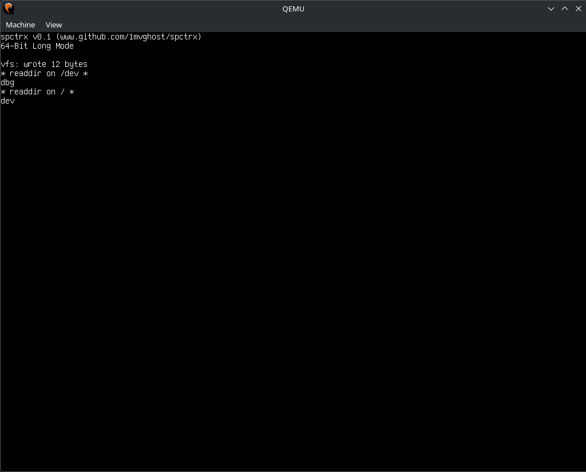

# spctrx
spctrx is a x86-64 hobby operating system written in C. It uses [Limine Bootloader](https://github.com/limine-bootloader/limine) for booting.

spctrx uses a custom kernel, which means it IS NOT based on Linux in any way & does NOT share any code with it.
</br>

 
</br>



# * features *
* ACPI <br/>
* VFS <br/>
* PCI device support (AHCI etc) <br/>
* Slab allocation <br/>
* PMM & VMM <br/>
* I/O APIC <br/>

There are a lot of upcoming features, such as multitasking.

# * compiling *
For compiling, you will need a x86_64-elf GCC cross compiler toolchain ([More info on that here](https://wiki.osdev.org/GCC_Cross-Compiler)), as well as NASM & xorriso (for image creation).

Before compiling, make sure to clone all project's submodules:
```bash
git submodule update --recursive --remote
```
To compile, go to the project's root and type:
```bash
make
```

# * booting *
Once you have a ready image, you can boot the OS on many things (such as real hardware, VirtualBox, QEMU etc)

For QEMU, an example command to boot spctrx is:
```bash
qemu-system-x86_64 -cdrom os.iso -m 4G -M q35 -cpu qemu64 -vga vmware -serial stdio
```

# * credits *
* [Limine Bootloader](https://github.com/limine-bootloader/limine) - Modern, secure, portable, multiprotocol bootloader and boot manager.
* [Flanterm](https://github.com/Mintsuki/Flanterm) - Fast and reasonably complete (framebuffer) terminal emulator.